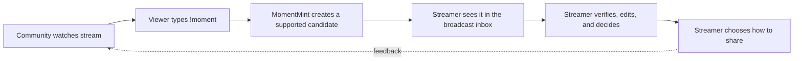
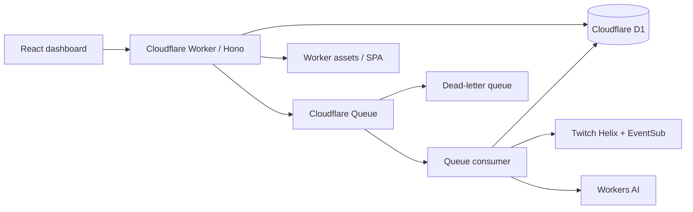
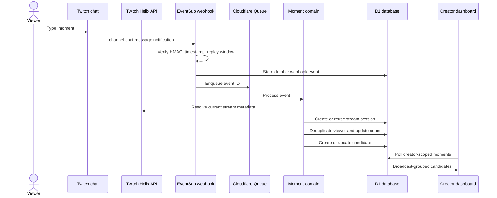
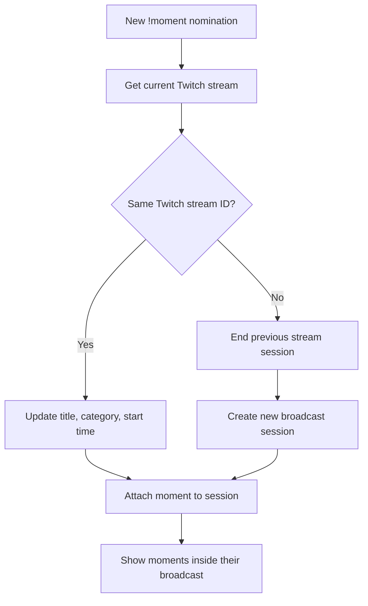
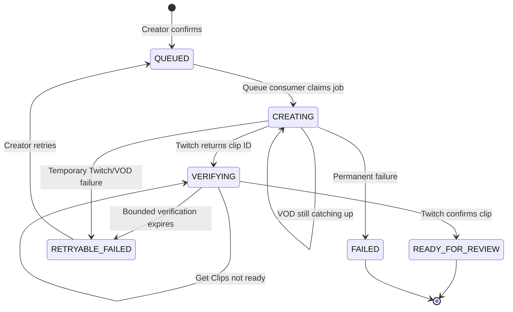
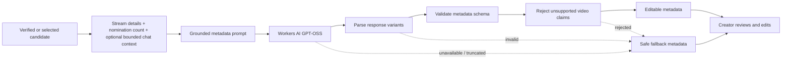

# MomentMint

> Turn community reactions into creator-controlled Twitch highlights.

MomentMint is a Twitch creator workspace that turns viewer `!moment` nominations into organized, verifiable clip candidates. It groups nominations by broadcast, counts distinct viewers, creates clips asynchronously through Twitch, and generates editable metadata with Workers AI.

The community identifies what deserves a second look. The creator stays in control of what gets clipped, reviewed, edited, and shared.

## Hackathon demo

Live demo: **[moment-mint.abbasbhp787.workers.dev](https://moment-mint.abbasbhp787.workers.dev)**

Recommended demo path:

1. Connect a Twitch broadcaster account.
2. Open Settings and register EventSub chat listening.
3. Send `!moment` in the broadcaster’s Twitch chat from one or more viewers.
4. Open the dashboard and select the resulting community candidate.
5. Create or retry the Twitch clip and wait for Twitch’s Get Clips confirmation.
6. Generate AI metadata, review the evidence notice, edit the fields, and mark the candidate reviewed.

The dashboard keeps candidates grouped under their broadcast so moments from separate streams do not get mixed together.

## How streamers and their Twitch communities use MomentMint

MomentMint is designed around a simple shared behavior: the community spots the moment, and the streamer decides what happens next.

### During the stream: the community signals the moment

When viewers see something worth saving, they type:

```text
!moment
```

MomentMint listens to the broadcaster’s Twitch chat through EventSub. It groups nearby nominations into one candidate and counts distinct viewers, so one person repeating the command cannot inflate the signal. A single nomination is still retained as a candidate; additional viewers simply increase its support.

The community does not need access to the dashboard, clip controls, or creator account. Their role is lightweight: keep watching, recognize a memorable moment, and nominate it in chat.

### After the stream: the streamer reviews the inbox

The streamer opens MomentMint’s dashboard to see candidates grouped under the broadcast where they happened. Each candidate shows its approximate nomination time, viewer support, clip status, and AI metadata status.

The streamer can then:

1. Open a candidate and inspect the verified Twitch clip.
2. Retry the clip if Twitch’s live recording was still catching up.
3. Generate editable title, summary, category, and social caption suggestions.
4. Review the evidence notice and edit every field before sharing.
5. Open Twitch’s edit flow or mark the candidate reviewed/dismissed.

### The collaboration loop



This keeps the community involved without giving automated systems permission to publish on the streamer’s behalf. The audience supplies discovery and enthusiasm; the streamer supplies context, judgment, and final approval.

## Why MomentMint?

Great stream moments are often discovered by the audience before the streamer notices them. Existing workflows make the creator manually search chat, remember timestamps, create clips, wait for Twitch publication, and write social copy.

MomentMint compresses that workflow into a creator-controlled inbox:

```text
Viewer types !moment
        ↓
EventSub webhook → durable queue → distinct-viewer grouping
        ↓
Broadcast-aware candidate inbox
        ↓
Twitch clip request → Get Clips verification
        ↓
Editable AI metadata → creator review
```

## What is implemented

### Community nominations

- Exact, case-insensitive `!moment` command handling.
- Distinct-viewer counting with duplicate protection.
- Configurable nomination threshold and grouping window.
- Candidates are preserved even when clipping or AI generation fails.

### Broadcast-aware organization

- Candidates are grouped by Twitch stream session.
- Current stream title, category, Twitch stream ID, and start time are synchronized from Twitch Get Streams.
- A new Twitch stream creates a new session instead of mixing moments with the previous broadcast.
- Stream groups and moments have explicit time/support sorting.

### Verified Twitch clips

- Manual clip creation with explicit creator confirmation.
- Optional automatic clipping, disabled by default.
- Twitch clip creation is asynchronous and retryable.
- A clip is not marked ready until Twitch confirms it through Get Clips.
- VOD-not-ready conditions are retried within a bounded window.
- Trusted Twitch URL validation protects preview and edit links.

### Responsible AI metadata

- Workers AI model: `@cf/openai/gpt-oss-20b`.
- Metadata is editable before sharing.
- The model is explicitly told that it has not watched the video.
- Unsupported visual, audio, gameplay, identity, and outcome claims are rejected.
- GPT-OSS response variants are parsed defensively, including reasoning truncation and wrapped JSON.
- AI failures produce safe fallback metadata rather than blocking the workflow.
- The UI explains whether metadata used community evidence, had no usable context, or fell back safely.

### Privacy and creator control

- Twitch tokens are encrypted server-side with AES-GCM.
- Browser clients never receive Twitch access or refresh tokens.
- Queue messages contain IDs and control data, not credentials or raw chat.
- Community context is opt-in, sanitized, creator-scoped, bounded, and short-lived.
- Chat context expires within 24 hours after metadata generation and never later than seven days after collection.
- MomentMint does not publish to social networks automatically.

## Architecture

```text
React + Vite SPA
       │
       ▼
Cloudflare Worker / Hono API
       │
       ├── Twitch OAuth + encrypted sessions
       ├── EventSub verification + webhook ingestion
       ├── D1 repositories and state transitions
       └── Queue producer
               │
               ▼
        Cloudflare Queues consumer
               │
               ├── Nomination grouping
               ├── Twitch stream synchronization
               ├── Clip creation and verification
               └── Workers AI metadata generation

Cloudflare D1 = durable source of truth
Cloudflare Queues = asynchronous work and retry boundary
Cloudflare Workers AI = editable metadata suggestions
Twitch Helix/EventSub = stream, chat, and clip lifecycle
```

### System architecture



### Nomination-to-candidate flow



### Broadcast grouping flow



### Clip lifecycle



### AI metadata flow



## How MomentMint uses Twitch

MomentMint uses Twitch for identity, live chat signals, stream identity, and clip creation. Twitch remains the source of truth for stream and clip availability; MomentMint stores workflow state and creator decisions around it.

| Twitch capability | API or mechanism | How MomentMint uses it |
|---|---|---|
| Creator connection | OAuth authorization code flow | Connects the broadcaster, validates the returned token, checks scopes, and encrypts access/refresh tokens server-side. |
| Chat nominations | EventSub `channel.chat.message` over webhook | Receives chat messages, verifies Twitch’s HMAC signature, ignores replays, and queues only a durable event ID for processing. |
| Stream identity | `GET /helix/streams?user_id=...&first=1` | Resolves the current Twitch stream ID, title, category, and start time so moments are separated by broadcast. |
| Current stream clip | `POST /helix/videos/clips` | Creates a clip from the matching VOD offset using the broadcaster/editor identity, duration, and title. |
| Clip verification | `GET /helix/clips?id=...` | Polls Twitch until the clip exists before marking it ready for review. |
| Clip editing | Twitch `edit_url` | Opens Twitch’s creator-controlled edit flow after validating and encrypting the URL. |
| Token health | OAuth token validation and refresh | Refreshes expiring tokens server-side and moves the creator to reconnect-required when refresh fails. |

### Required Twitch scopes

The OAuth flow requests and validates:

```text
user:read:chat
user:bot
channel:bot
channel:manage:clips
```

### Why clip verification is asynchronous

Twitch creates clips asynchronously. MomentMint therefore keeps a clip in a creating or verifying state and calls Get Clips before showing it as ready. If the live VOD has not caught up yet, the candidate remains available for bounded retry instead of being discarded.

See the [Twitch API reference](https://dev.twitch.tv/docs/api/reference) for the official stream and clip endpoint contracts.

## Technology

- React 19 + TypeScript
- Vite + Cloudflare Vite plugin
- Cloudflare Workers
- Hono
- Cloudflare D1 (SQLite)
- Cloudflare Queues + dead-letter queue
- Cloudflare Workers AI
- Twitch OAuth, EventSub, and Helix API
- TanStack Query
- Tailwind CSS + shadcn-style UI primitives
- Vitest + Cloudflare Vitest plugin
- Oxlint

## Repository structure

```text
src/                    React dashboard and product UI
worker/                 Hono routes, domain logic, Twitch, AI, queues
shared/                 Shared Zod contracts and state definitions
database/               D1 schema and forward-only migrations
tests/                  Unit and Cloudflare Worker integration tests
plans/                  Product and implementation phase plans
scripts/                Production checks and deployment helpers
wrangler.jsonc          Cloudflare Worker, D1, Queue, and AI bindings
```

## Run locally

### Requirements

- Node.js compatible with the checked-in toolchain
- pnpm
- A Cloudflare account for Worker/D1/Queue integration
- A Twitch developer application for OAuth and EventSub

### Install and start

```sh
pnpm install
pnpm exec wrangler d1 migrations apply momentmint --local
pnpm dev
```

Copy `.dev.vars.example` to `.dev.vars` and provide local values. `.dev.vars` is ignored by Git and must never be committed.

Useful local endpoints:

```text
/health
/health/ready
```

Twitch EventSub requires a public HTTPS callback URL, so full chat ingestion is intended for a deployed Worker or a secure tunnel with a matching Twitch callback.

## Production deployment

Authenticate Wrangler against the intended Cloudflare account:

```sh
pnpm exec wrangler login
```

Create or configure the production resources:

```sh
pnpm exec wrangler d1 create momentmint
pnpm exec wrangler queues create momentmint-jobs
pnpm exec wrangler queues create momentmint-jobs-dlq
```

Set the production D1 ID and public URLs in `wrangler.jsonc`. The Twitch callback must exactly match:

```text
https://YOUR_HOST/oauth/twitch/callback
```

Set secrets through Wrangler:

```sh
pnpm exec wrangler secret put TWITCH_CLIENT_SECRET
pnpm exec wrangler secret put TOKEN_ENCRYPTION_KEY
pnpm exec wrangler secret put SESSION_SECRET
pnpm exec wrangler secret put EVENTSUB_SECRET
```

`TOKEN_ENCRYPTION_KEY` must be a base64 encoding of 32 random bytes. Generate one locally with:

```sh
node -e "console.log(require('crypto').randomBytes(32).toString('base64'))"
```

Deploy with the guarded production command:

```sh
pnpm run deploy:production
```

The command runs production configuration checks, applies pending remote D1 migrations, builds the Worker and SPA, removes local production artifacts, and deploys the Worker.

## Configuration

Public Worker variables:

| Variable | Purpose |
|---|---|
| `APP_BASE_URL` | Public Worker origin |
| `TWITCH_CLIENT_ID` | Twitch application client ID |
| `TWITCH_REDIRECT_URI` | Exact OAuth callback URL |
| `AI_MODEL_ID` | Workers AI model, currently `@cf/openai/gpt-oss-20b` |
| `DEFAULT_GROUP_WINDOW_SECONDS` | Default nomination grouping window |
| `DEFAULT_UNIQUE_VIEWER_THRESHOLD` | Default distinct-viewer threshold |

Secrets:

| Secret | Purpose |
|---|---|
| `TWITCH_CLIENT_SECRET` | Twitch OAuth exchange and token refresh |
| `TOKEN_ENCRYPTION_KEY` | AES-GCM encryption for Twitch tokens and edit URLs |
| `SESSION_SECRET` | Creator session signing/encryption |
| `EVENTSUB_SECRET` | Twitch webhook signature verification |

Never place secrets in source control, frontend environment variables, screenshots, logs, or README files.

## Verification

Run the complete local quality gate:

```sh
pnpm test
pnpm run build
pnpm run lint
pnpm run production:check
git diff --check
```

After deployment:

```sh
curl https://YOUR_HOST/health
curl https://YOUR_HOST/health/ready
pnpm exec wrangler tail moment-mint
```

For a real Twitch validation, verify OAuth, EventSub registration, a chat nomination, stream grouping, clip creation, Get Clips confirmation, metadata generation, fallback behavior, and creator review.

## API surface

| Route | Purpose |
|---|---|
| `GET /health` | Liveness check |
| `GET /health/ready` | D1 and production configuration readiness |
| `GET /oauth/twitch/start` | Start Twitch OAuth |
| `GET /oauth/twitch/callback` | Complete Twitch OAuth |
| `POST /webhooks/twitch` | Receive verified EventSub notifications |
| `GET /api/dashboard/overview` | Dashboard metrics and current stream |
| `GET /api/moments` | List creator-scoped candidates |
| `GET /api/moments/:momentId` | Candidate detail, clips, nominations, metadata |
| `POST /api/moments/:momentId/clip` | Request a creator-confirmed clip |
| `POST /api/clip-jobs/:clipJobId/retry` | Retry an eligible clip job |
| `POST /api/moments/:momentId/ai-metadata` | Queue metadata generation |
| `PATCH /api/moments/:momentId/metadata` | Save edited metadata |
| `POST /api/moments/:momentId/review` | Mark a candidate reviewed or dismissed |
| `GET /api/settings` | Read creator settings and disclosures |
| `PATCH /api/settings` | Update creator settings |

All `/api/*` routes are creator-authenticated and creator-scoped.

## License and hackathon note

This repository is prepared as a hackathon submission and is not presented as a finished commercial service. Review the configured Twitch and Cloudflare terms, quotas, pricing, and production limits before operating it at scale.
