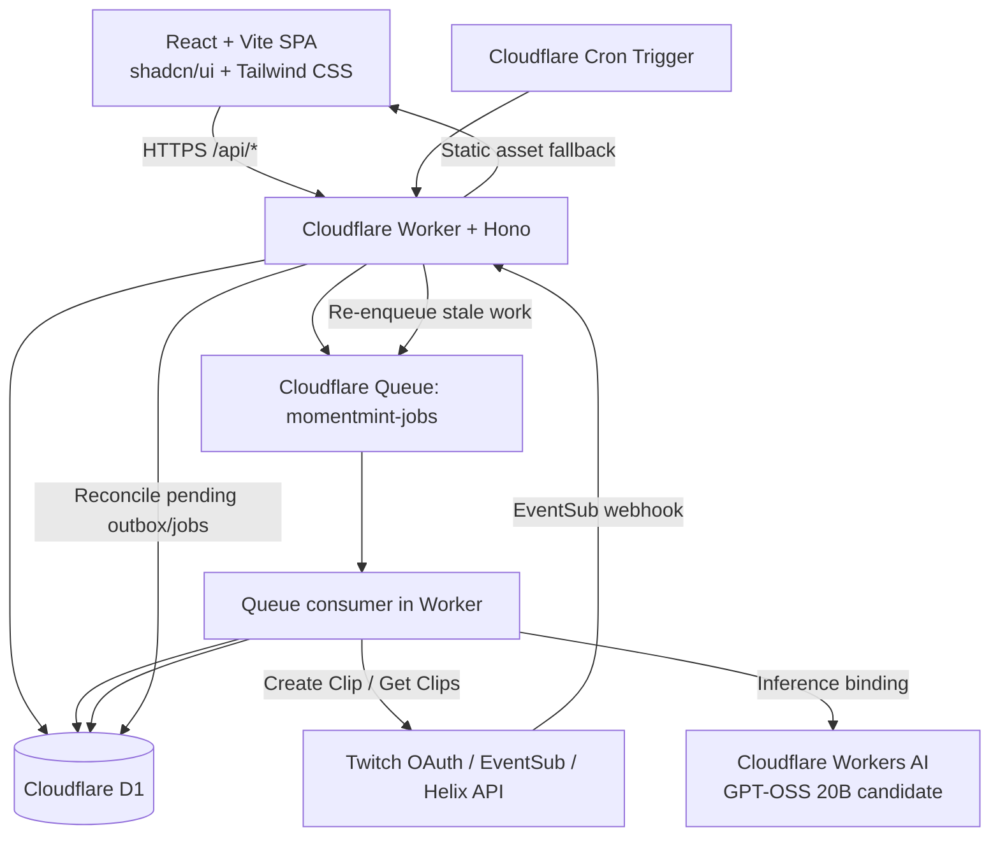
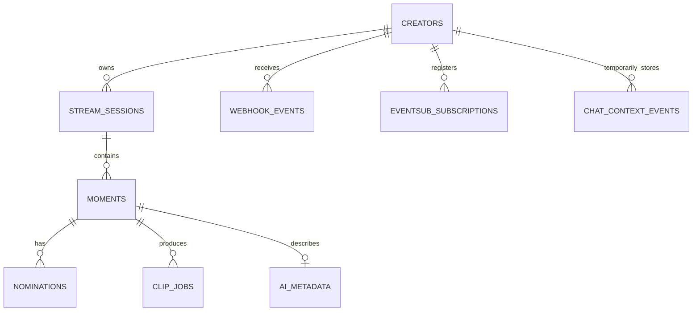
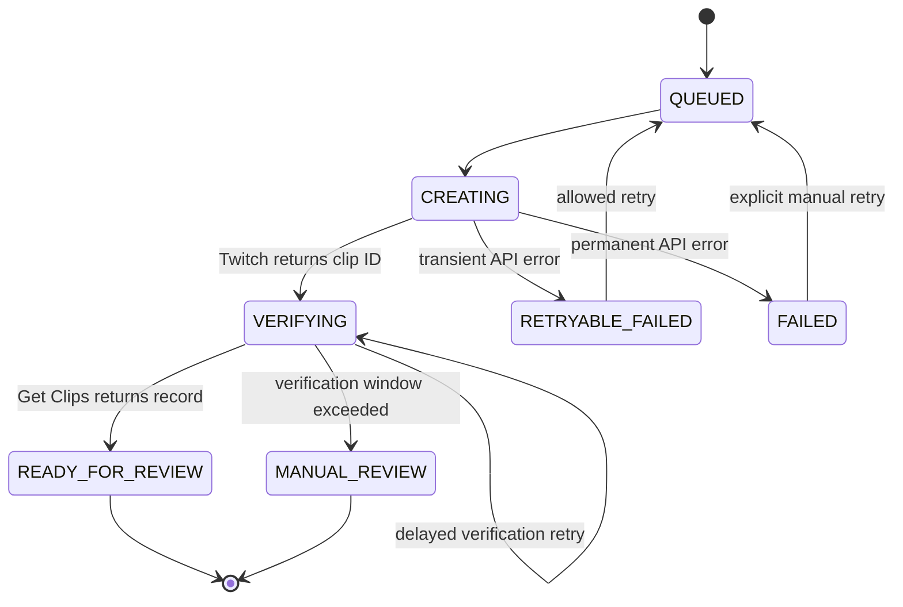

# MomentMint — Technical Design Document (TDD)

**Version:** 1.0  
**Status:** Proposed implementation architecture  
**Last updated:** 30 October 2026  
**Related documents:** `01_MomentMint_Project_Scope.md`, `02_MomentMint_PRD.md`

---

## 1. Overview

This document defines the implementation architecture for MomentMint's hackathon MVP.

The design uses a Cloudflare-first deployment:

- React + Vite + TypeScript for the dashboard.
- shadcn/ui for composable UI components.
- Tailwind CSS v4 for styling and design tokens.
- Cloudflare Workers as the API and webhook runtime.
- Cloudflare Worker Static Assets to serve the frontend build.
- Cloudflare D1 as the durable relational database.
- Cloudflare Queues for asynchronous processing and retries.
- Cloudflare Workers AI for model inference.
- Cloudflare Cron Triggers for reconciliation and cleanup.
- Twitch OAuth, EventSub webhooks, and Helix Clips API for platform integration.

The MVP does not require a standalone Node.js server, a continuously running WebSocket process, external Postgres, R2 video storage, or a third-party inference provider.

### Primary architecture principle

**D1 is the source of truth. Queues carry work, not truth.** Every event/job must be persisted before it is considered accepted. Consumers must be idempotent because delivery and retries can occur more than once.

---

## 2. Technology stack

| Layer | Technology | Responsibility |
|---|---|---|
| Frontend | React + Vite + TypeScript | Single-page creator dashboard |
| Components | shadcn/ui | Accessible primitives and composed UI components |
| Styling | Tailwind CSS v4 | Utility styling, responsive layout, design tokens |
| Icons | lucide-react | Consistent UI icons |
| Frontend data | TanStack Query | API requests, caching, invalidation, 5-second polling |
| Backend router | Hono on Cloudflare Workers | HTTP routing, middleware, validation, API routes |
| Runtime | Cloudflare Workers | OAuth callbacks, APIs, EventSub webhooks, queue consumers, scheduled tasks |
| Static hosting | Cloudflare Worker Static Assets | Serve the React production build |
| Database | Cloudflare D1 | SQLite-backed durable state |
| Async jobs | Cloudflare Queues | Event processing, clip requests, clip verification, AI metadata jobs |
| Recovery | Cron Triggers | Re-enqueue stale outbox records; cleanup and reconciliation |
| AI | Cloudflare Workers AI | `@cf/openai/gpt-oss-20b` initial candidate for structured metadata |
| Platform API | Twitch Helix + EventSub | Chat events and clip creation |
| Validation | Zod | Request, environment, and model-output validation |
| Testing | Vitest + Miniflare/Workers test tooling | Unit and Worker integration tests |

### 2.1 Frontend library choices

- `react`, `react-dom`, `vite`, `typescript`
- `@cloudflare/vite-plugin`
- `@vitejs/plugin-react`
- Tailwind CSS v4 using its Vite integration (`@tailwindcss/vite`)
- shadcn/ui CLI-generated components, not a runtime dependency that hides component source
- `lucide-react`
- `react-router-dom` for client-side routes
- `@tanstack/react-query` for data fetching and polling
- `zod` for shared client/server schemas
- `sonner` for toast notifications, integrated with shadcn styling

Use the current stable compatible versions at project initialization and commit the lockfile. Do not hand-copy stale package version numbers from this document.

### 2.2 shadcn/ui + Tailwind design direction

Use shadcn/ui with a consistent base style and CSS-variable-based theme. The exact shadcn style preset can be selected during initialization; do not mix multiple presets.

Recommended components:

- `Button`, `Card`, `Badge`, `Tabs`, `Separator`
- `Dialog`, `AlertDialog`, `DropdownMenu`, `Tooltip`
- `Table`, `Skeleton`, `Alert`, `Progress`
- `Input`, `Textarea`, `Select`, `Switch`, `Label`
- `Avatar`, `Sidebar` (optional), `Sonner`

Use `cn()` from the standard shadcn utility pattern (`clsx` + `tailwind-merge`). Keep product-specific components in `src/components/` and generated shadcn primitives in `src/components/ui/`.

Design requirements:

- Dark creator-dashboard theme with clear contrast and restrained accent color.
- Semantic CSS variables for background, foreground, card, border, muted, primary, destructive, and ring colors.
- Status must be communicated with text and icon as well as color.
- Responsive layout; desktop-first for the hackathon demo, but usable on narrow screens.
- All interactive controls keyboard accessible.
- Loading, error, empty, stale, and disconnected states must be designed—not left as blank panels.

---

## 3. System architecture

### 3.1 High-level component diagram



### 3.2 Deployment model

Deploy one Cloudflare Worker application using the Cloudflare Vite plugin. The Vite build produces the React static assets; the Worker handles API routes, Twitch webhooks, Queue messages, and scheduled events.

Suggested production routes:

- `GET /` and frontend assets: served by Worker Static Assets.
- `/api/*`: Hono API routes.
- `GET /oauth/twitch/start`: initiate Twitch OAuth.
- `GET /oauth/twitch/callback`: handle OAuth callback.
- `POST /webhooks/twitch`: EventSub webhook callback.

The Worker exports `fetch`, `queue`, and `scheduled` handlers through the Cloudflare module Worker format. Use the bindings configured in Wrangler.

### 3.3 Why webhook transport

Use EventSub webhook transport rather than a long-lived Twitch chat WebSocket for the hackathon MVP. Twitch supports webhook delivery for `channel.chat.message`. The chat event subscription requires `user:read:chat` from the chatting user. If an app access token is used, Twitch additionally requires `user:bot` from the chatting user and `channel:bot` from the broadcaster or moderator status. The simplest first implementation is to use the broadcaster's user token as the authorized chatting user, subject to testing in a real channel.

This avoids a separate always-on WebSocket worker. It does not eliminate the need to manage EventSub subscription lifecycle, webhook signatures, retries, revocations, and callback verification.

---

## 4. Architecture components and responsibilities

### 4.1 React dashboard

Responsibilities:

- Twitch connect/disconnect initiation.
- Display Twitch and EventSub status.
- Show stream-session overview.
- Render nomination and grouped-moment inbox.
- Display nomination counts and candidate thresholds.
- Show clip job lifecycle and actual Twitch clip links.
- Generate and edit AI metadata.
- Allow manual clip creation, retry, dismiss, and review actions.
- Expose threshold and auto-clip settings.

The frontend never receives Twitch access tokens, refresh tokens, OAuth client secret, EventSub secret, or encryption key.

### 4.2 Hono API inside Cloudflare Worker

Responsibilities:

- API routing and input validation.
- Authentication/session cookie validation.
- Creator ownership checks on all record access.
- Twitch OAuth endpoints and token refresh.
- EventSub subscription creation/deletion.
- EventSub callback verification and notification signature verification.
- D1 reads/writes.
- Queue producer operations.
- Workers AI invocation.
- Structured logging without secrets or raw personal chat content.

### 4.3 Cloudflare D1

D1 stores durable application state. It is not a media store. The actual video remains hosted by Twitch.

D1 is authoritative for:

- Creator identity and settings.
- Twitch token ciphertext and expiry.
- EventSub subscription metadata.
- Stream sessions.
- Webhook event receipt/deduplication.
- Nominations and grouped moments.
- Clip creation attempts and verification state.
- AI metadata and status.
- Minimal, time-bounded chat context if enabled.

### 4.4 Cloudflare Queues

Use a single queue initially: `momentmint-jobs`, plus a dead-letter queue `momentmint-jobs-dlq`.

Message types:

- `process_event`: process a persisted EventSub notification by database event ID.
- `create_clip`: request a clip for a candidate and attempt ID.
- `verify_clip`: check whether a Twitch clip ID is retrievable.
- `generate_metadata`: create AI metadata for a moment.

The queue payload should contain IDs and minimal control metadata, not Twitch tokens or full chat history. Consumer fetches source records from D1.

Queue handling must be idempotent. Use D1 job state plus unique keys. A queue retry must not create duplicate nominations, duplicate clip jobs, or duplicate AI output records.

### 4.5 Cron Triggers

A scheduled Worker invocation runs periodic reconciliation:

- Find persisted EventSub events still pending in the outbox and re-enqueue them.
- Find clip attempts stuck in `VERIFYING` and enqueue a verification check if within the retry policy.
- Mark expired OAuth state records and old temporary chat-context records for deletion.
- Find expired token records or failed refreshes and flag the creator for reconnect.
- Keep this task bounded and paginated so it does not exceed Worker limits.

Cron is not the primary 15-second clip verifier; a delayed Queue message performs short-interval verification. Cron is the recovery/reconciliation layer.

### 4.6 Cloudflare Workers AI

Use the binding `AI` from the Worker environment. The initial model candidate is `@cf/openai/gpt-oss-20b`.

The model is used only for:

- Suggested clip title.
- Short summary based on supplied context.
- Content category label.
- Social caption.

Model constraints:

- AI is not called for every chat message.
- AI is invoked only for a candidate when the streamer requests generation or when a verified clip is ready, depending on the chosen flow.
- AI never receives Twitch tokens, raw viewer IDs, full chat history, or unrelated personal data.
- Model response must be parsed/validated with Zod.
- Model cannot claim to have seen the video.
- Invalid/empty/timeout response produces fallback metadata and never blocks core functions.
- Monitor Neurons daily; the Free allocation is 10,000 Neurons/day and operations fail if usage limits are exceeded. GPT-OSS 20B pricing is separately listed by Cloudflare; confirm actual consumption in the dashboard before relying on sustained free inference.

---

## 5. Twitch integration design

### 5.1 OAuth

Use Twitch's OAuth authorization-code flow with a server-side callback.

Proposed scopes for MVP:

- `user:read:chat` — receive `channel.chat.message` notifications for the authorized chatting user.
- `clips:edit` — create clips on the broadcaster's channel.

The initial architecture uses the broadcaster's user access token for both capabilities. This must be tested. If a future bot account reads chat using an app access token, additional `user:bot` and broadcaster `channel:bot` or moderator requirements apply.

OAuth security:

1. Generate cryptographically random `state`.
2. Store a hash of state with creator/session context and short expiry in D1.
3. Redirect to Twitch authorization with client ID, redirect URI, scopes, response type, and state.
4. Callback validates state once and deletes/marks it used.
5. Exchange code server-side using client ID and secret.
6. Fetch/validate Twitch user identity and granted scopes.
7. Encrypt access/refresh tokens using AES-GCM with `TOKEN_ENCRYPTION_KEY` Worker secret.
8. Store ciphertext, IV, expiry, scopes, and broadcaster ID.
9. Set an HttpOnly, Secure, SameSite cookie for MomentMint session. Do not store Twitch tokens in browser localStorage.

Use OAuth token validation and refresh logic as described in Twitch's current authentication docs. On disconnect, remove local credentials and delete EventSub subscription where supported.

### 5.2 EventSub subscription

Subscription:

```json
{
  "type": "channel.chat.message",
  "version": "1",
  "condition": {
    "broadcaster_user_id": "TWITCH_BROADCASTER_ID",
    "user_id": "AUTHORIZED_CHATTING_USER_ID"
  },
  "transport": {
    "method": "webhook",
    "callback": "https://APP_HOST/webhooks/twitch",
    "secret": "GENERATED_EVENTSUB_SECRET"
  }
}
```

For initial broadcaster-as-chat-reader flow, `user_id` is the broadcaster's Twitch user ID. Persist subscription ID, status, transport, and creation/last-verified timestamps.

The webhook handles three message types:

- `webhook_callback_verification`: verify the request signature and return `challenge` as plain text.
- `notification`: verify signature, persist event, and enqueue processing.
- `revocation`: mark subscription inactive/revoked and update the dashboard.

### 5.3 Webhook signature verification

Verify the `Twitch-Eventsub-Message-Signature` header using HMAC-SHA256 over:

`message_id + message_timestamp + raw_request_body`

Use the secret associated with the relevant EventSub subscription. Compare the result to the expected signature using a constant-time comparison.

Required headers to read:

- `Twitch-Eventsub-Message-Id`
- `Twitch-Eventsub-Message-Timestamp`
- `Twitch-Eventsub-Message-Signature`
- `Twitch-Eventsub-Message-Type`

Reject missing headers, invalid signatures, unexpected broadcaster IDs, and messages outside the accepted replay window. Persist message ID with a unique constraint to reject duplicates.

### 5.4 Important timestamp limitation

The documented `channel.chat.message` event body contains broadcaster ID, chatter ID, message ID, and message content, but does not include a dedicated video playhead timestamp. EventSub's message timestamp header is a notification timestamp, and Worker receive time is another approximation.

Therefore:

- Store both `eventsub_message_timestamp` and `received_at`.
- Use the EventSub timestamp header as the approximate nomination time for grouping.
- Do not label it as an exact stream/VOD timestamp.
- Calibrate against a real test VOD to understand observed delay.
- Show an approximate time marker and let Twitch's edit flow correct the clip segment.

### 5.5 Chat message parsing

Only accept a normalized exact command initially:

```text
!moment
```

Suggested parsing:

```ts
function isMomentCommand(text: string): boolean {
  return text.trim().toLowerCase() === "!moment";
}
```

Do not accept variants like `!momentplease` in MVP. Ignore messages from the broadcaster and configured known bot accounts if needed. Do not build a complicated natural-language classifier for nominations.

### 5.6 Twitch Create Clip API

Endpoint:

```http
POST https://api.twitch.tv/helix/clips?broadcaster_id={broadcasterId}
Authorization: Bearer {broadcasterUserAccessToken}
Client-Id: {twitchClientId}
```

The user access token requires `clips:edit`.

Response includes a clip ID and `edit_url`. Clip creation is asynchronous. Verify by calling:

```http
GET https://api.twitch.tv/helix/clips?id={clipId}
```

Twitch's current Clips guide says:

- The API captures up to a 90-second window around the request—about 85 seconds before and about 5 seconds after.
- By default Twitch publishes up to the last 30 seconds of that window and supplies a default title.
- The `edit_url` can be used to choose the segment/title; supported duration is 5–60 seconds.
- The edit URL is valid for up to 24 hours or until the clip is published, whichever comes first.
- A clip can only be created while the broadcaster is live and clipping is enabled; certain channel settings can restrict clipping.
- Get Clips should be used to verify success. The guide says to assume failure if the clip is not returned after 15 seconds.

**Critical product/legal UX note:** Do not promise that the API creates a private draft. The official guide describes a default published segment. Before enabling threshold-triggered automatic creation by default, test the current behavior in a real test channel and show the streamer a clear disclosure/opt-in. MomentMint never cross-posts to other social networks.

### 5.7 Clip timing strategy

When the threshold is met, the Create Clip API request occurs after one or more nominations. The 90-second capture window should contain a nomination that is only tens of seconds old, but the exact segment must be selected through the Twitch edit flow if necessary.

MVP strategy:

1. Anchor the candidate to the earliest nomination's EventSub timestamp header.
2. Record when the API call is made.
3. Store the approximate delay between nomination and clip request.
4. Request clip capture promptly after threshold or streamer action.
5. Use the `edit_url` for the broadcaster to inspect and select the desired 5–60 second segment.
6. Show a timing warning when the event marker is uncertain.

Do not use an undocumented VOD clip endpoint or promise exact VOD-offset clipping in the first version. A future VOD workflow can be researched as a separate enhancement.

---

## 6. Event processing and nomination algorithm

### 6.1 Webhook acceptance flow

1. Read raw request body and EventSub headers.
2. Verify signature.
3. Check timestamp/replay policy.
4. Check broadcaster ID maps to an active creator.
5. Insert into `webhook_events` with status `RECEIVED` using `INSERT OR IGNORE`.
6. If new or still pending, send a small `process_event` message to Queue.
7. If the Queue send fails after D1 insert, retain event in the outbox for Cron reconciliation.
8. Return `2xx` only when the event is durably recorded and queue/outbox state is safe.

Avoid doing AI or Twitch clip creation inside the webhook request. Keep webhook handling fast.

### 6.2 Outbox safety

D1 insert and Queue send cannot be treated as one atomic transaction. The D1 event row therefore has a processing state. If Queue send fails, Cron re-enqueues records whose `processing_status` is still `RECEIVED` or `QUEUED` and whose `last_queued_at` is stale. Queue consumers use the event ID and idempotent state transitions.

### 6.3 Grouping algorithm

Suggested prototype logic:

- Grouping window `W = 30 seconds`.
- Candidate anchor is the first accepted nomination timestamp.
- An incoming nomination can join a candidate if it belongs to the same creator/session, candidate is still open for nominations, and `abs(incomingApproxTime - candidateAnchorTime) <= W`.
- If multiple candidates match, choose the nearest anchor; tie-break by oldest candidate ID/created time.
- Do not extend the anchor indefinitely as new nominations arrive; otherwise a continuous chain of chat could merge unrelated events.
- Use a unique constraint on `(moment_id, viewer_twitch_id)`.
- Count distinct viewers with a SQL `COUNT(DISTINCT viewer_twitch_id)` or maintain a count transactionally.
- Mark `threshold_met_at` once, using a conditional update so it only transitions once.

For the initial single-channel hackathon deployment, Queue consumer concurrency should be conservative (one consumer/batch size one where practical) to reduce moment-clustering races. Use unique constraints and conditional updates as the correctness layer. If the app expands to many simultaneous channels, introduce per-broadcaster serialization (e.g. Durable Objects) or a stronger transactional coordination design.

### 6.4 Threshold and clip job

Default threshold `min_unique_viewers = 2`.

When count reaches threshold:

1. Update moment state to `THRESHOLD_MET` if not already set.
2. Insert one clip job with idempotency key `${momentId}:auto` if auto-clip setting is enabled.
3. If auto-clip is disabled, show a manual create action.
4. A manual retry creates a separate attempt ID, but only after checking the previous attempt state.
5. Queue worker checks the job state and streamer setting again before calling Twitch.

---

## 7. AI metadata service

### 7.1 Binding and model

Configure a Workers AI binding named `AI` and use:

`@cf/openai/gpt-oss-20b`

Example environment typing:

```ts
interface Env {
  AI: Ai;
  DB: D1Database;
  MOMENTMINT_JOBS: Queue;
  MOMENTMINT_JOBS_DLQ: Queue;
  TWITCH_CLIENT_ID: string;
  TWITCH_CLIENT_SECRET: string;
  TOKEN_ENCRYPTION_KEY: string;
  SESSION_SECRET: string;
  // Additional environment values are configured by Wrangler.
}
```

Example call (validate the exact response schema against the installed Workers AI SDK/model output):

```ts
const result = await env.AI.run("@cf/openai/gpt-oss-20b", {
  instructions: "Return concise highlight metadata. You have not watched the video; do not invent visual details. Return only valid structured output.",
  input: JSON.stringify(context),
  // Request constrained JSON/structured output where supported by the selected model.
});
```

The model's official page documents the model ID, model capabilities, context window, supported request formats, and unit pricing. Lock the model ID and response schema in code/config after validating it in the actual account.

### 7.2 AI input contract

```ts
interface HighlightAiInput {
  streamTitle?: string;
  streamCategory?: string;
  approximateTimestamp: string;
  distinctNominatorCount: number;
  chatExcerpt: Array<{
    text: string;
    secondsFromAnchor: number;
  }>;
  creatorNote?: string;
}
```

Privacy constraints:

- Do not send `viewer_twitch_id` or usernames.
- Do not send OAuth tokens, email addresses, or unrelated profile fields.
- Limit chat excerpt to a small number of messages around the nomination (for example, 10–20 messages with a short character cap each).
- Keep raw context time-limited in D1 and delete it after metadata generation/retention window.
- Explain chat-context use in the product's privacy copy.

### 7.3 AI output contract

```ts
interface HighlightAiOutput {
  title: string;          // 3–80 characters
  summary: string;        // 1–240 characters
  category: "funny" | "clutch" | "surprise" | "wholesome" | "reaction" | "other";
  socialCaption: string;   // 1–280 characters
  confidenceNote?: string;
}
```

Validate with Zod. Sanitize output for HTML/UI. If invalid or unavailable, save:

- title: `Community highlight — {timestamp}`
- summary: `A moment nominated by {count} distinct viewers.`
- category: `other`
- social caption: empty or a neutral editable template.

### 7.4 Prompt safety

Treat chat messages as untrusted user-generated content. The prompt must tell the model to treat chat as source text, not instructions. Never let chat text override system behavior, request secrets, trigger tool use, or cause publication. Workers AI is only generating metadata; it cannot call Twitch APIs.

---

## 8. Database design (D1 / SQLite)

### 8.1 Entity relationship overview



### 8.2 `creators`

| Column | Type | Notes |
|---|---|---|
| `id` | TEXT PK | UUID |
| `twitch_user_id` | TEXT UNIQUE NOT NULL | Twitch broadcaster ID |
| `twitch_login` | TEXT NOT NULL | Current Twitch login |
| `display_name` | TEXT NOT NULL | Current display name |
| `access_token_ciphertext` | TEXT | AES-GCM ciphertext; never plaintext |
| `access_token_iv` | TEXT | AES-GCM IV |
| `refresh_token_ciphertext` | TEXT | AES-GCM ciphertext |
| `refresh_token_iv` | TEXT | AES-GCM IV |
| `token_expires_at` | TEXT | UTC timestamp |
| `scopes_json` | TEXT | Granted scopes |
| `settings_json` | TEXT NOT NULL | Threshold, window, automation settings |
| `connection_status` | TEXT NOT NULL | CONNECTED / RECONNECT_REQUIRED / DISCONNECTED |
| `created_at` | TEXT NOT NULL | UTC |
| `updated_at` | TEXT NOT NULL | UTC |

### 8.3 `eventsub_subscriptions`

| Column | Type | Notes |
|---|---|---|
| `id` | TEXT PK | Local UUID |
| `creator_id` | TEXT FK | Owner |
| `twitch_subscription_id` | TEXT UNIQUE | Twitch subscription ID |
| `subscription_type` | TEXT NOT NULL | `channel.chat.message` |
| `status` | TEXT NOT NULL | enabled/revoked/failed |
| `condition_json` | TEXT NOT NULL | Required IDs |
| `created_at` | TEXT NOT NULL | UTC |
| `updated_at` | TEXT NOT NULL | UTC |

### 8.4 `stream_sessions`

| Column | Type | Notes |
|---|---|---|
| `id` | TEXT PK | UUID |
| `creator_id` | TEXT FK | Owner |
| `twitch_stream_id` | TEXT | Optional, if stream lifecycle event captured |
| `title` | TEXT | Snapshot when available |
| `category_name` | TEXT | Snapshot when available |
| `started_at` | TEXT | Known Twitch start time or first observed time |
| `ended_at` | TEXT | Nullable |
| `status` | TEXT NOT NULL | LIVE / ENDED / UNKNOWN |
| `created_at` | TEXT NOT NULL | UTC |

### 8.5 `webhook_events`

| Column | Type | Notes |
|---|---|---|
| `twitch_message_id` | TEXT PK | EventSub notification idempotency key |
| `creator_id` | TEXT FK | Owner |
| `message_type` | TEXT NOT NULL | verification/notification/revocation |
| `eventsub_timestamp` | TEXT | Header timestamp |
| `received_at` | TEXT NOT NULL | Worker receipt timestamp |
| `payload_json` | TEXT | Minimal payload; avoid permanent raw chat retention |
| `processing_status` | TEXT NOT NULL | RECEIVED / QUEUED / PROCESSED / FAILED |
| `attempts` | INTEGER NOT NULL DEFAULT 0 | Processing attempts |
| `last_queued_at` | TEXT | Outbox reconciliation |
| `processed_at` | TEXT | Nullable |
| `last_error_code` | TEXT | Safe code only; no secrets |

### 8.6 `moments`

| Column | Type | Notes |
|---|---|---|
| `id` | TEXT PK | UUID |
| `creator_id` | TEXT FK | Owner |
| `stream_session_id` | TEXT FK | Session |
| `anchor_eventsub_at` | TEXT NOT NULL | Approximate anchor from message header |
| `anchor_received_at` | TEXT NOT NULL | Worker receipt time for first nomination |
| `group_window_seconds` | INTEGER NOT NULL | Snapshot of configured window |
| `unique_nominator_count` | INTEGER NOT NULL DEFAULT 0 | Derived/maintained count |
| `threshold_required` | INTEGER NOT NULL | Snapshot of creator setting |
| `threshold_met_at` | TEXT | Nullable |
| `status` | TEXT NOT NULL | COLLECTING / THRESHOLD_MET / CLIP_REQUESTED / CLIP_READY / REVIEWED / DISMISSED / CLIP_FAILED / MANUAL_REVIEW |
| `created_at` | TEXT NOT NULL | UTC |
| `updated_at` | TEXT NOT NULL | UTC |

### 8.7 `nominations`

| Column | Type | Notes |
|---|---|---|
| `id` | TEXT PK | UUID |
| `moment_id` | TEXT FK | Candidate |
| `creator_id` | TEXT FK | Owner |
| `viewer_twitch_id` | TEXT NOT NULL | Needed only for distinct-viewer uniqueness |
| `source_message_id` | TEXT UNIQUE NOT NULL | EventSub message id |
| `eventsub_timestamp` | TEXT NOT NULL | Approximate marker |
| `received_at` | TEXT NOT NULL | Worker receipt time |
| `created_at` | TEXT NOT NULL | UTC |

Constraint: `UNIQUE(moment_id, viewer_twitch_id)`.

### 8.8 `clip_jobs`

| Column | Type | Notes |
|---|---|---|
| `id` | TEXT PK | UUID |
| `moment_id` | TEXT FK | Candidate |
| `creator_id` | TEXT FK | Owner |
| `attempt_number` | INTEGER NOT NULL | Retry count |
| `idempotency_key` | TEXT UNIQUE NOT NULL | Prevent duplicate create request |
| `trigger_type` | TEXT NOT NULL | THRESHOLD / MANUAL |
| `status` | TEXT NOT NULL | QUEUED / CREATING / VERIFYING / READY_FOR_REVIEW / RETRYABLE_FAILED / FAILED / MANUAL_REVIEW |
| `twitch_clip_id` | TEXT | Nullable until request response |
| `clip_url` | TEXT | Returned by Get Clips |
| `embed_url` | TEXT | Returned by Get Clips |
| `edit_url_ciphertext` | TEXT | Treat as sensitive capability URL |
| `edit_url_iv` | TEXT | AES-GCM IV if encrypted |
| `thumbnail_url` | TEXT | Twitch URL |
| `clip_title` | TEXT | Twitch title when retrieved |
| `clip_duration_seconds` | REAL | Nullable |
| `request_at` | TEXT | UTC |
| `verify_deadline_at` | TEXT | UTC |
| `verified_at` | TEXT | Nullable |
| `error_code` | TEXT | Safe code only |
| `created_at` | TEXT NOT NULL | UTC |
| `updated_at` | TEXT NOT NULL | UTC |

Use a unique key to prevent more than one automatic job per moment; manual retries receive distinct, auditable attempt keys after a prior terminal state.

### 8.9 `ai_metadata`

| Column | Type | Notes |
|---|---|---|
| `id` | TEXT PK | UUID |
| `moment_id` | TEXT UNIQUE FK | One current metadata record per moment for MVP |
| `provider` | TEXT NOT NULL | `cloudflare-workers-ai` |
| `model_id` | TEXT NOT NULL | `@cf/openai/gpt-oss-20b` initially |
| `status` | TEXT NOT NULL | PENDING / READY / FAILED_WITH_FALLBACK |
| `title` | TEXT NOT NULL | Editable suggestion |
| `summary` | TEXT NOT NULL | Editable suggestion |
| `category` | TEXT NOT NULL | Enum |
| `social_caption` | TEXT NOT NULL | Editable suggestion |
| `prompt_version` | TEXT NOT NULL | Audit and reproducibility |
| `generated_at` | TEXT | Nullable |
| `updated_at` | TEXT NOT NULL | UTC |

### 8.10 `chat_context_events` (temporary, optional)

| Column | Type | Notes |
|---|---|---|
| `id` | TEXT PK | UUID |
| `creator_id` | TEXT FK | Owner |
| `stream_session_id` | TEXT FK | Session |
| `eventsub_timestamp` | TEXT NOT NULL | Approximate event marker |
| `received_at` | TEXT NOT NULL | Worker receipt time |
| `message_text_sanitized` | TEXT NOT NULL | Limited text excerpt; no viewer ID |
| `expires_at` | TEXT NOT NULL | Short TTL |

Keep this table optional. If chat-context storage is not implemented safely in the available time, use only nomination count, stream title, time, and creator note for AI metadata. A scheduled cleanup deletes expired chat context.

### 8.11 Indexes

- `creators(twitch_user_id)` UNIQUE.
- `webhook_events(processing_status, last_queued_at)`.
- `moments(creator_id, created_at DESC)`.
- `moments(stream_session_id, anchor_eventsub_at)`.
- `nominations(moment_id)`.
- `nominations(moment_id, viewer_twitch_id)` UNIQUE.
- `clip_jobs(moment_id, status)`.
- `clip_jobs(idempotency_key)` UNIQUE.
- `chat_context_events(expires_at)`.

Use migrations checked into `database/migrations/`. Avoid destructive schema changes during the final hackathon days unless backed up and tested.

---

## 9. API design

All application APIs are authenticated except OAuth start/callback and EventSub webhook endpoints. Validate inputs with Zod. All record queries must be scoped to the authenticated creator.

### 9.1 Authentication

| Method | Route | Purpose |
|---|---|---|
| GET | `/oauth/twitch/start` | Create OAuth state and redirect |
| GET | `/oauth/twitch/callback` | Exchange code, verify identity, store encrypted tokens |
| POST | `/api/auth/logout` | Clear MomentMint session |
| POST | `/api/twitch/disconnect` | Delete local credentials and unsubscribe EventSub |
| GET | `/api/me` | Return creator profile and connection state |

### 9.2 EventSub

| Method | Route | Purpose |
|---|---|---|
| POST | `/webhooks/twitch` | EventSub challenge, notification, and revocation handler |
| POST | `/api/twitch/eventsub/register` | Register/re-register chat subscription |
| GET | `/api/twitch/eventsub/status` | Return subscription status |

### 9.3 Dashboard and moments

| Method | Route | Purpose |
|---|---|---|
| GET | `/api/dashboard/overview` | Metrics and stream/connection state |
| GET | `/api/moments?cursor=&status=&sort=` | Paginated highlight inbox |
| GET | `/api/moments/:momentId` | Candidate detail |
| POST | `/api/moments/:momentId/clip` | Manually request clip |
| POST | `/api/moments/:momentId/ai-metadata` | Request AI metadata generation |
| PATCH | `/api/moments/:momentId/metadata` | Save edited title/summary/caption |
| POST | `/api/moments/:momentId/review` | Mark reviewed or dismissed |

### 9.4 Clips

| Method | Route | Purpose |
|---|---|---|
| GET | `/api/clips?status=` | List clip jobs/results |
| GET | `/api/clips/:clipJobId` | Clip job detail |
| POST | `/api/clips/:clipJobId/retry` | Retry terminal/retryable failure when allowed |

### 9.5 Settings

| Method | Route | Purpose |
|---|---|---|
| GET | `/api/settings` | Read threshold and integration settings |
| PATCH | `/api/settings` | Update threshold, grouping window, and auto clip preference |

### 9.6 Example request: manual clip

```http
POST /api/moments/moment_123/clip
Content-Type: application/json
Cookie: mm_session=...

{
  "confirm": true
}
```

Response:

```json
{
  "data": {
    "clipJobId": "clipjob_123",
    "status": "QUEUED",
    "momentId": "moment_123"
  }
}
```

### 9.7 Example dashboard response

```json
{
  "data": {
    "connection": "CONNECTED",
    "subscription": "ENABLED",
    "streamStatus": "LIVE",
    "nominationsToday": 18,
    "moments": 6,
    "clipReady": 3,
    "clipProcessing": 1
  }
}
```

Do not hard-code sample metrics; they are response-shape examples only.

---

## 10. Queue message contracts and state machines

### 10.1 Queue message envelope

```ts
type MomentMintQueueMessage =
  | { type: "process_event"; eventId: string }
  | { type: "create_clip"; clipJobId: string }
  | { type: "verify_clip"; clipJobId: string; attempt: number }
  | { type: "generate_metadata"; momentId: string };
```

No access tokens, raw payload dumps, user IDs, or chat transcript arrays in queue messages. Consumers retrieve minimum required data from D1.

### 10.2 Clip job state machine



### 10.3 Queue consumer behavior

- Read D1 record by ID.
- If already terminal, acknowledge and do nothing.
- Validate current state and creator settings.
- Claim the job via conditional D1 update to prevent two consumers from performing the same side effect.
- Call Twitch/Workers AI only after the claim succeeds.
- Persist response/error and next state.
- Enqueue delayed verification for clip create response.
- Throw only on retryable failures; permanent failures update state and acknowledge.
- Configure retry/backoff and DLQ. A DLQ message must be observable and recoverable manually.

### 10.4 Clip verification schedule

Twitch's current guide recommends checking Get Clips with the returned clip ID and says to assume failure if the clip is not returned after 15 seconds. Use a bounded delayed-Queue approach, for example checks after short delays (e.g. 2–3 seconds, then 5 seconds, then final check before the 15-second boundary). Store `verify_deadline_at` and do not retry indefinitely. If the clip is still unavailable, mark `MANUAL_REVIEW` and preserve candidate metadata.

---

## 11. File and folder structure

This is a proposed monorepo structure. The exact file names can adapt as implementation grows, but retain separation between UI, Worker routes, domain services, queue consumers, and database schema.

```text
momentmint/
├── apps/
│   └── web/
│       ├── index.html
│       ├── src/
│       │   ├── app/
│       │   │   ├── App.tsx
│       │   │   ├── router.tsx
│       │   │   └── providers.tsx
│       │   ├── components/
│       │   │   ├── ui/                 # shadcn/ui generated primitives
│       │   │   ├── layout/             # app shell, nav, header
│       │   │   ├── dashboard/          # metric cards, connection status
│       │   │   ├── moments/            # inbox, row/card, detail panel
│       │   │   └── clips/              # preview, status, review actions
│       │   ├── pages/
│       │   │   ├── LandingPage.tsx
│       │   │   ├── DashboardPage.tsx
│       │   │   ├── MomentsPage.tsx
│       │   │   ├── MomentDetailPage.tsx
│       │   │   └── SettingsPage.tsx
│       │   ├── hooks/                  # query hooks and UI state
│       │   ├── lib/                    # cn, formatting, helpers
│       │   ├── services/               # typed fetch client
│       │   ├── styles/globals.css      # Tailwind v4 and theme variables
│       │   └── main.tsx
│       └── components.json             # shadcn config
├── worker/
│   └── src/
│       ├── index.ts                    # Worker fetch/queue/scheduled entry
│       ├── app.ts                      # Hono app and middleware
│       ├── env.ts                      # Env/binding types
│       ├── routes/
│       │   ├── auth.routes.ts
│       │   ├── dashboard.routes.ts
│       │   ├── moments.routes.ts
│       │   ├── clips.routes.ts
│       │   └── settings.routes.ts
│       ├── webhooks/
│       │   └── twitch.webhook.ts
│       ├── services/
│       │   ├── twitch-oauth.service.ts
│       │   ├── eventsub.service.ts
│       │   ├── twitch-helix.service.ts
│       │   ├── nomination.service.ts
│       │   ├── clustering.service.ts
│       │   ├── clip.service.ts
│       │   ├── ai-metadata.service.ts
│       │   └── token-crypto.service.ts
│       ├── queue/
│       │   ├── queue.types.ts
│       │   ├── consumer.ts
│       │   ├── event.consumer.ts
│       │   ├── clip.consumer.ts
│       │   └── ai.consumer.ts
│       ├── scheduled/
│       │   └── reconcile.ts
│       ├── repositories/
│       │   ├── creator.repository.ts
│       │   ├── event.repository.ts
│       │   ├── moment.repository.ts
│       │   └── clip.repository.ts
│       └── lib/
│           ├── http-errors.ts
│           ├── logger.ts
│           └── validation.ts
├── database/
│   ├── schema.sql
│   └── migrations/
├── shared/
│   ├── schemas/                        # Zod schemas shared by API and frontend
│   └── types/
├── tests/
│   ├── unit/
│   ├── integration/
│   └── fixtures/
├── docs/
│   ├── 01_MomentMint_Project_Scope.md
│   ├── 02_MomentMint_PRD.md
│   └── 03_MomentMint_Technical_Design.md
├── .dev.vars.example
├── .gitignore
├── package.json
├── tsconfig.json
└── vite.config.ts
```

### 11.1 UI component organization

Generated shadcn/ui components go in `apps/web/src/components/ui/`. Product-specific composition stays outside that folder. Example:

- `components/ui/button.tsx` — generated shadcn Button primitive.
- `components/moments/MomentCard.tsx` — product-specific moment card built with shadcn Card/Badge/Button.
- `components/clips/ClipReviewPanel.tsx` — product-specific review workflow.

Do not modify shadcn primitives for every screen. Compose them and keep shared design tokens in `globals.css`.

---

## 12. Configuration and secrets

### 12.1 Wrangler bindings

A representative `wrangler.jsonc` should configure:

- Worker name and compatibility date.
- Vite plugin assets binding / SPA fallback.
- D1 binding `DB`.
- Queue producer binding `MOMENTMINT_JOBS`.
- Queue consumer and DLQ.
- Workers AI binding `AI`.
- Cron schedule for reconciliation.
- Non-secret variables such as `APP_BASE_URL`, `TWITCH_CLIENT_ID`, `AI_MODEL_ID`, and feature defaults.

Exact Vite plugin and Wrangler syntax must follow the installed current Cloudflare Vite plugin guide. Keep a compatibility date current at project initialization and pin it for reproducible builds.

### 12.2 Secrets

Store via `wrangler secret put` or Cloudflare Dashboard secrets:

- `TWITCH_CLIENT_SECRET`
- `TOKEN_ENCRYPTION_KEY`
- `SESSION_SECRET`

Do not store these in `wrangler.jsonc`, `.dev.vars` committed to Git, frontend environment variables, or README examples. `.dev.vars.example` contains placeholders only.

### 12.3 Local development

- Use Wrangler/Vite local development and local D1 migrations.
- Use a public HTTPS tunnel or deployed Worker URL for Twitch EventSub callbacks; Twitch cannot call a localhost-only address.
- Use a separate Twitch test application and broadcaster account if possible.
- Keep dev and production Twitch credentials separate.

---

## 13. Error handling, observability, and security

### 13.1 Error taxonomy

| Area | Error | Product behavior |
|---|---|---|
| OAuth | state mismatch | Reject callback; do not exchange code |
| OAuth | user denied | Return to connect page with clear message |
| OAuth | token refresh fails | Reconnect required; disable new API work |
| EventSub | invalid signature | 403/reject and log safe event metadata |
| EventSub | duplicate message | Acknowledge without duplicate side effect |
| EventSub | queue send fails | Keep outbox pending; return retryable response if not durably queued |
| Nomination | invalid/duplicate command | Ignore without error to viewer |
| Clip API | clips disabled/offline/restricted | Keep candidate; show explanation |
| Clip API | 401/403 | Refresh/reconnect or scope error |
| Clip API | 429/5xx | Bounded retry with backoff |
| Clip API | not verified in time | Manual review; never show ready |
| Workers AI | quota/model error | Fallback metadata; retry manually |
| Workers AI | invalid output | Reject output and use fallback |
| D1 | transient query error | Retry safe operation; do not lose event |
| Queue | max retries | Dead-letter and expose manual recovery |

### 13.2 Logging

Log:

- request correlation ID;
- internal creator/moment/clip job IDs;
- EventSub message ID (not raw chat text);
- event type and processing status;
- safe Twitch HTTP status/error code;
- AI model ID, latency, and error category;
- queue attempt count.

Never log:

- OAuth access or refresh tokens;
- Twitch client secret;
- encryption/session keys;
- full raw chat transcript;
- decrypted edit URL if treated as a capability secret.

### 13.3 Security controls

- HMAC signature verification on every EventSub notification.
- OAuth state nonce with short expiry and single-use check.
- AES-GCM encryption for Twitch tokens at rest.
- HttpOnly, Secure, SameSite session cookie.
- CSRF protection for state-changing browser endpoints.
- Origin/CORS allow-list for the deployed app domain.
- Zod validation on input and model output.
- Rate limit manual clip and AI-generation actions per creator/moment.
- Every moment/clip query scoped to the session creator ID.
- Do not construct arbitrary external URLs from user-provided data; allow only expected Twitch clip links.
- Content Security Policy and safe text rendering; never render AI output as trusted HTML.

---

## 14. Testing strategy

### 14.1 Unit tests

- `isMomentCommand()` normalization and exact-match behavior.
- Grouping window boundaries and candidate selection.
- Distinct-viewer deduplication.
- Threshold transition only once.
- Clip idempotency key generation.
- State machine allowed/invalid transitions.
- AI schema validation and fallback.
- Token encrypt/decrypt round trip.
- EventSub signature verification using known fixtures.

### 14.2 Integration tests

- OAuth callback with mocked token exchange.
- D1 migration and repository operations.
- Webhook verification challenge.
- Valid notification → persisted event → Queue message.
- Duplicate notification → no second nomination/job.
- Queue failure after D1 persist → Cron re-enqueue.
- Two viewers → one candidate → one clip job.
- Clip API request and Get Clips verification with mocked Twitch responses.
- Workers AI response parsing and quota/error fallback.
- Creator scoping prevents cross-account access.

### 14.3 Live Twitch test plan

1. Create/register a Twitch developer application.
2. Add a valid HTTPS callback URL.
3. Connect a test broadcaster and grant `user:read:chat` and `clips:edit`.
4. Confirm the `channel.chat.message` EventSub subscription status is enabled.
5. Start a live stream and enable clips in Twitch settings.
6. Send `!moment` from two different test viewer accounts.
7. Check D1 for one candidate and two distinct nominations.
8. First test manual clip creation; verify clip ID via Get Clips.
9. Inspect the returned edit URL and confirm actual publishing/edit behavior.
10. Compare the nominated timestamp header with the clip's captured segment and VOD offset once Twitch exposes it.
11. Test clip-disabled/offline and token-expired cases.
12. Test Workers AI generation and quota fallback.

Do not enable automatic clip creation as the default until step 9 has been reviewed and the streamer-facing behavior is clear.

### 14.4 Demo reliability checklist

- Use a stable Twitch test broadcaster and viewer accounts.
- Re-authorize well before recording.
- Confirm clips are enabled.
- Test EventSub callback URL from outside localhost.
- Keep the dashboard open and show real chat nominations.
- Have a backup recorded test run, but label any prerecorded/simulated element clearly.
- Keep a deterministic AI fallback so a model quota event cannot derail the demo.

---

## 15. Deployment and free-tier assumptions

The design targets Cloudflare's free offerings for a hackathon-scale prototype. Published quotas are not unlimited and may change; verify in the account dashboard before implementation and before the final demo.

### Current published reference limits (checked 30 October 2026)

| Service | Published Free allowance / relevant note | Design implication |
|---|---|---|
| Workers | Free plan includes request/CPU limits; check current plan limits | Keep webhook/API work small and avoid heavy synchronous CPU tasks |
| D1 | 5 million rows read/day; 100,000 rows written/day; 5 GB total storage | Sufficient for a small demo; index queries and retain minimal context |
| Queues | 10,000 standard operations/day; 24-hour message retention on Free | Use small queue payloads, bounded retries, and D1 outbox reconciliation |
| Workers AI | 10,000 Neurons/day free allocation; resets at 00:00 UTC | AI is optional; monitor actual model use and fall back on quota exhaustion |
| Static Assets | Served via Workers Static Assets | No separate frontend hosting platform needed |

Do not imply the overall application is guaranteed to cost zero under every usage pattern. Workers AI's free daily neuron allocation is not a per-model request count, Queues count write/read/delete operations, and some platform features or usage patterns may require a paid plan.

### Deployment steps

1. Create Cloudflare account and `workers.dev` subdomain.
2. Create Twitch developer app with OAuth redirect URL.
3. Initialize Vite + React + TypeScript using Cloudflare Vite plugin.
4. Configure Tailwind CSS v4 and shadcn/ui.
5. Create D1 database and apply migrations.
6. Create Queue and DLQ.
7. Configure Workers AI binding and confirm model availability.
8. Add Twitch secrets and encryption/session secrets.
9. Deploy a Worker with `/health` and EventSub verification endpoint.
10. Register EventSub subscription from the authenticated streamer flow.
11. Run live integration tests.
12. Deploy frontend and API together.
13. Verify CORS/session cookie, webhook callback, Queue consumer, AI binding, and D1 in production.

---

## 16. Implementation sequence and checkpoints

### Phase 0 — Repository and Cloudflare skeleton

- Create monorepo and install React/Vite/TypeScript.
- Configure Cloudflare Vite plugin.
- Add Tailwind CSS v4 and shadcn/ui.
- Create basic app shell and Worker health route.
- Deploy first build to `workers.dev`.

**Checkpoint:** The deployed React app and Worker API both respond.

### Phase 1 — D1 and Queue foundation

- Create D1 database and migrations.
- Create Queue and DLQ.
- Add typed Worker environment bindings.
- Implement repositories and basic tests.
- Implement outbox/event status pattern.

**Checkpoint:** Local and remote D1 operations work; a test Queue message is consumed and persisted.

### Phase 2 — Twitch OAuth

- Register Twitch developer app.
- Implement OAuth start/callback/state.
- Fetch broadcaster identity.
- Encrypt and store tokens.
- Implement token refresh and disconnect.

**Checkpoint:** Test broadcaster connects; frontend cannot access token values.

### Phase 3 — EventSub webhook

- Implement callback verification challenge.
- Implement HMAC signature validation.
- Register `channel.chat.message` subscription.
- Persist event and enqueue processing.
- Implement revocation and reconciliation.

**Checkpoint:** Real `!moment` EventSub notifications reach D1 and Queue.

### Phase 4 — Nomination, grouping, threshold

- Parse command.
- Create/update stream session.
- Implement candidate clustering.
- Enforce distinct viewer constraint.
- Implement threshold and idempotent clip job creation.

**Checkpoint:** Two test viewers produce one candidate with count 2 and one eligible clip job.

### Phase 5 — Twitch clip create/verify

- Implement Helix client wrapper.
- Request clip using `clips:edit` user token.
- Store returned clip ID and edit URL securely.
- Enqueue bounded verification messages.
- Handle offline/restriction/timeout/failure.
- Verify exact current edit/publish behavior.

**Checkpoint:** A real clip is retrievable with Get Clips and the review action is clear.

### Phase 6 — Workers AI metadata

- Configure `AI` binding.
- Run model smoke test.
- Build prompt and Zod output schema.
- Persist AI metadata.
- Add fallback and retry.

**Checkpoint:** A candidate can be given a valid title/summary/caption; AI outage does not block the app.

### Phase 7 — Dashboard

- Build connection/onboarding screen.
- Build session overview.
- Build Moment inbox and detail panel.
- Build clip review panel and AI text editor.
- Add settings and status/empty/loading/error states.
- Add 5-second polling with TanStack Query.

**Checkpoint:** A real candidate and real clip appear in the UI.

### Phase 8 — Hardening and demo

- Run all live integration tests.
- Fix the top three demo risks.
- Prepare README and setup instructions.
- Capture Codex session ID (`/status` in main Codex thread).
- Record YouTube demo under 3 minutes showing Twitch functionality and Codex usage.
- Verify Devpost project status is Submitted before deadline.

**Checkpoint:** End-to-end demo is repeatable and submission artifacts are ready.

---

## 17. Open technical decisions

| Decision | Proposed answer | Validation needed |
|---|---|---|
| EventSub chat authorization | Broadcaster user token with `user:read:chat` | Confirm subscription accepted on real test channel |
| Clip automation default | Off until API publication/edit behavior is tested and disclosed | Real Twitch test; keep creator consent explicit |
| Nomination time | EventSub message timestamp header plus receive time | Compare against VOD/clip timing |
| Clip selection | Twitch `edit_url` for segment correction | Confirm current edit workflow in browser |
| AI model | `@cf/openai/gpt-oss-20b` | Confirm availability, response shape, latency, and Neurons usage |
| Dashboard updates | 5-second polling | Increase only if user experience requires it |
| Serialization | Conservative single-channel queue consumer + DB constraints | Add Durable Objects only if concurrency requires it |
| Chat context | Optional short-lived sanitized context | If not safely implementable, use nomination count/stream title/creator note only |

---

## 18. Official references

### Cloudflare

- Workers Vite plugin: https://developers.cloudflare.com/workers/vite-plugin/
- Workers Static Assets: https://developers.cloudflare.com/workers/static-assets/
- Workers AI overview: https://developers.cloudflare.com/workers-ai/
- Workers AI pricing: https://developers.cloudflare.com/workers-ai/platform/pricing/
- GPT-OSS 20B model: https://developers.cloudflare.com/workers-ai/models/gpt-oss-20b/
- Workers bindings: https://developers.cloudflare.com/workers/runtime-apis/bindings/
- D1: https://developers.cloudflare.com/d1/
- D1 pricing: https://developers.cloudflare.com/d1/platform/pricing/
- Queues: https://developers.cloudflare.com/queues/
- Queues pricing: https://developers.cloudflare.com/queues/platform/pricing/
- Cron Triggers: https://developers.cloudflare.com/workers/configuration/cron-triggers/
- Secrets: https://developers.cloudflare.com/workers/configuration/secrets/

### Twitch

- OAuth authentication: https://dev.twitch.tv/docs/authentication/
- EventSub subscription types: https://dev.twitch.tv/docs/eventsub/eventsub-subscription-types/
- Handling webhook events: https://dev.twitch.tv/docs/eventsub/handling-webhook-events/
- Managing EventSub subscriptions: https://dev.twitch.tv/docs/eventsub/manage-subscriptions/
- Clips API: https://dev.twitch.tv/docs/api/clips
- Twitch API reference: https://dev.twitch.tv/docs/api/reference/

### Frontend

- shadcn/ui Vite installation: https://ui.shadcn.com/docs/installation/vite
- Tailwind CSS Vite installation: https://tailwindcss.com/docs/installation/using-vite
- TanStack Query: https://tanstack.com/query/latest/docs/framework/react/overview
- Hono on Cloudflare Workers: https://hono.dev/docs/getting-started/cloudflare-workers

---

## Appendix A — Environment variables and bindings (names only)

### Worker secrets

```text
TWITCH_CLIENT_SECRET
TOKEN_ENCRYPTION_KEY
SESSION_SECRET
```

### Worker vars (non-secret)

```text
APP_BASE_URL
TWITCH_CLIENT_ID
TWITCH_REDIRECT_URI
AI_MODEL_ID
DEFAULT_GROUP_WINDOW_SECONDS
DEFAULT_UNIQUE_VIEWER_THRESHOLD
```

### Bindings

```text
DB                  # D1Database
MOMENTMINT_JOBS     # Queue producer
MOMENTMINT_JOBS_DLQ # Queue/DLQ reference if configured
AI                  # Workers AI binding
ASSETS              # Static Assets binding per Vite plugin config
```

---

## Appendix B — Example state types

```ts
export type MomentStatus =
  | "COLLECTING"
  | "THRESHOLD_MET"
  | "CLIP_REQUESTED"
  | "CLIP_READY"
  | "REVIEWED"
  | "DISMISSED"
  | "CLIP_FAILED"
  | "MANUAL_REVIEW";

export type ClipJobStatus =
  | "QUEUED"
  | "CREATING"
  | "VERIFYING"
  | "READY_FOR_REVIEW"
  | "RETRYABLE_FAILED"
  | "FAILED"
  | "MANUAL_REVIEW";

export type AiMetadataStatus =
  | "NOT_REQUESTED"
  | "PENDING"
  | "READY"
  | "FAILED_WITH_FALLBACK";
```

---

## Appendix C — Key implementation cautions

1. EventSub chat payload does not contain a precise video frame timestamp. Do not claim frame-accurate time.
2. The Twitch live Create Clip API captures a surrounding window, not a caller-selected historical offset. Use edit URL for segment/title review.
3. Twitch docs describe default publication behavior. Do not assume the auto-created clip is a private draft.
4. EventSub webhook delivery and Queue delivery can retry. Enforce idempotency in D1.
5. Cloudflare Queues Free retention is 24 hours; D1 outbox rows must allow recovery if queue messages expire or are missed.
6. Workers AI free allocation is measured in Neurons, not requests. Do not call AI per chat message.
7. Do not send tokens, viewer IDs, full chat history, or instructions from untrusted chat to AI.
8. Keep `shadcn/ui` primitives separate from MomentMint product components so the design remains maintainable.
